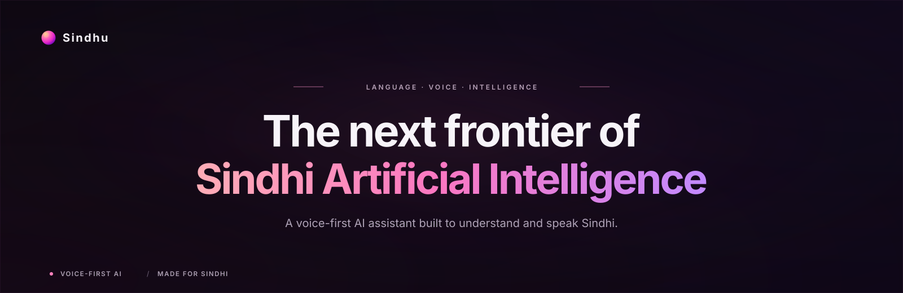

# Sindhu

**Sindhu is a voice first ai assistant, that can understand and speak in Sindhi language.**

AI Research in Sindhi language is evoluting at a fast pace; moreover, Sindhu can be a good contributer in it.

[Live Demo Link](https://sindhu-teal.vercel.app/) · [Report Bug, Request Feature](ibrahimbhatti.dev@gmail.com) 

> **Prototype Notice:** This project is an early stage prototype (MVP) features are actively changing, performance is not fully optimized.

## The Philosophy Behind Sindhu

Mainstream voice AI platforms like ElevenLabs and ChatGPT Voice have made massive strides in multilingual audio yet they still struggle to understand and speak Sindhi accurately and naturally. On the other hand dedicated research labs like AI4Bharat and BodhanAI have invested deeply in training models for Indic languages including Sindhi. However their work is offered as separate APIs for individual tasks like speech-to-text, translation, and text-to-speech, rather than a complete voice assistant.

To bridge this gap I built a pipeline that connects these separate APIs with a Large Language Model (LLM), turning them into a working, end to end Sindhi voice assistant.

## Feedback

I'm actively looking for early user feedback! If you have a suggestion please reach out at ibrahimbhatti.dev@gmail.com.

